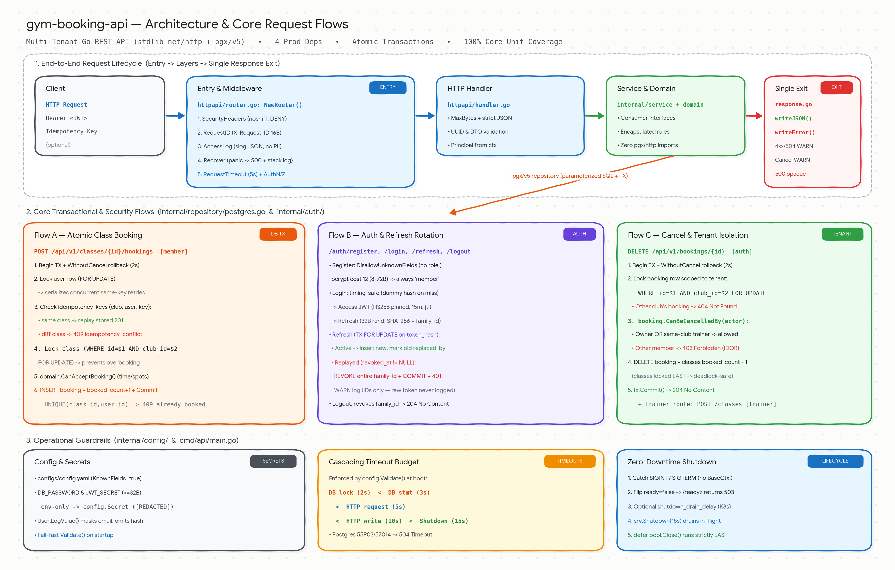

# gym-booking-api

A multi-tenant gym booking API in Go. Clubs are isolated by `club_id`; members
book classes, trainers create them, and refresh tokens rotate. I kept the HTTP,
service, and SQL layers small enough to read in one sitting.

## Request Entry & Response Exit

| Stage | Location |
| --- | --- |
| Entry point | `internal/httpapi/router.go` → `NewRouter` |
| Booking handler | `internal/httpapi/handler.go` → `(*Handler).bookClass` |
| Service | `internal/service/booking_service.go` → `(*BookingService).BookClass` |
| Transaction | `internal/repository/postgres.go` → `(*Postgres).CreateBooking` |
| Responses | `internal/httpapi/response.go` → `writeJSON`, `writeError`, `writeNoContent` |

## Architecture & Flows



| Access | Endpoints |
| --- | --- |
| Public | `GET /healthz`, `GET /readyz`, `POST /api/v1/auth/register`, `POST /api/v1/auth/login`, `POST /api/v1/auth/refresh` |
| Authenticated | `POST /api/v1/auth/logout`, `GET /api/v1/classes` |
| Trainer | `POST /api/v1/classes` |
| Member | `POST /api/v1/classes/{id}/bookings` (optional `Idempotency-Key`) |
| Owner or trainer | `DELETE /api/v1/bookings/{id}` |

Errors: `{"code":"...","message":"...","request_id":"...","fields":{...}}` (`fields` is omitted when empty).

## Configuration

Non-secret settings live in `configs/config.yaml`; YAML is decoded with
`KnownFields(true)`, so typos fail at startup. `DB_PASSWORD` and `JWT_SECRET`
(32+ bytes) come only from the environment. `Config.Validate()` enforces the
timeout chain `lock_timeout < statement_timeout < request_timeout < write_timeout
< shutdown_timeout`.

## Quickstart & End-to-End Demo

```bash
cp .env.example .env
make up
```

The seeded `member@club-a.test`, `trainer@club-a.test`, and `member@club-b.test`
accounts all use `Password123!`. In another terminal:

```bash
LOGIN=$(curl -sS -X POST localhost:8080/api/v1/auth/login \
  -H 'Content-Type: application/json' \
  -d '{"email":"member@club-a.test","password":"Password123!"}')
TOKEN=$(jq -r .access_token <<<"$LOGIN")
REFRESH=$(jq -r .refresh_token <<<"$LOGIN")

BOOKING_ID=$(curl -sS -X POST \
  localhost:8080/api/v1/classes/33333333-3333-3333-3333-333333333301/bookings \
  -H "Authorization: Bearer $TOKEN" -H 'Idempotency-Key: demo-1' | jq -r .id)
REPLAY_ID=$(curl -sS -X POST \
  localhost:8080/api/v1/classes/33333333-3333-3333-3333-333333333301/bookings \
  -H "Authorization: Bearer $TOKEN" -H 'Idempotency-Key: demo-1' | jq -r .id)
test "$BOOKING_ID" = "$REPLAY_ID" && echo "same booking: $BOOKING_ID"

curl -sS -o /dev/null -w 'logout=%{http_code}\n' -X POST \
  localhost:8080/api/v1/auth/logout -H "Authorization: Bearer $TOKEN" \
  -H 'Content-Type: application/json' -d "{\"refresh_token\":\"$REFRESH\"}"
```

Reset everything with `make down-v`.

## Running Tests

Mocks live in `mock_*_test.go`; regenerate them with `make generate`. Run
`make check` on a clean tree because it also checks for mock drift.

```bash
make test              # unit + HTTP, no Docker
make cover             # 100% statement coverage on core packages
make test-integration  # full suite with Testcontainers
make check             # format, vet, deps, coverage, shuffled tests
make generate          # regenerate mocks
make vuln              # govulncheck
make help              # list targets
```

The integration suite covers booking/cancellation, refresh rotation and reuse,
idempotency, tenant isolation, and SQL-injection handling against a real
`postgres:16-alpine` container. `testify`, `go.uber.org/mock`, and
`testcontainers-go` are test-only; `make check-prod-deps` confirms they never
enter `./cmd/api`.

## Interview Walkthrough Map

| # | Topic | Where |
| --- | --- | --- |
| 1 | Error handling | `internal/httpapi/response.go` → `writeError`; `internal/domain/errors.go` |
| 2 | Error logging & PII | `internal/httpapi/middleware.go` → `AccessLog`, `Recover`; `internal/domain/models.go` → `User.LogValue`; `internal/config/secret.go` |
| 3 | Clean code & readability | `internal/httpapi/router.go` → `chain`; `internal/httpapi/handler.go` → request/response DTOs |
| 4 | Secrets & config | `internal/config/config.go` → `Load`, `Validate`; `internal/config/secret.go` → `Secret`; `internal/repository/postgres.go` → `NewPostgresPool` |
| 5 | Login & permissions | `internal/service/auth_service.go` → `Register`, `Login`, `Refresh`, `Logout`; `internal/auth/jwt.go` |
| 6 | Modular design | `internal/service/auth_service.go` → consumer interfaces; `internal/httpapi/handler.go` → `AuthService`, `BookingService`; `cmd/api/main.go` |
| 7 | Auth boundaries | `internal/httpapi/middleware.go` → `RequireAuth`, `RequireRole`; `internal/auth/context.go`; `internal/repository/postgres.go` → `club_id` filters |
| 8 | Database access | `internal/repository/postgres.go` → `CreateBooking`, `CancelBooking`, `RotateRefreshToken`, `translate`; `migrations/001_init.sql` |
| 9 | Tests & operations | `Makefile`; `.github/workflows/ci.yml`; `internal/repository/postgres_integration_test.go` |

## What I Would Improve Next

- **Token lifecycle.** Add a `jti` denylist in Redis for immediate access-token
  revocation, plus a scheduled cleanup for expired refresh/idempotency rows.
- **Rate limiting.** Put token-bucket limits at the gateway or in Redis before
  login, refresh, and booking traffic reaches the API.
- **Migrations.** Replace the initdb SQL with `goose` or `golang-migrate` so
  schema changes have versions, ordering, and rollback.
- **Observability.** Add `otelhttp` + `otelpgx` on top of the current structured
  logs and `X-Request-ID`.
- **Edge cases.** Stored-response idempotency still returns the original `201`
  after a cancellation; `register` also exposes existing email/club IDs. In
  production I'd add async email verification and a clearer onboarding flow.

## Review & Deployment

When I review a PR here, I check four things:

- `club_id` scoping and the authorization check on every authenticated path.
- Parameterized SQL and the transaction boundary around booking and refresh writes.
- PII or secrets leaking through logs, error bodies, or `fmt` output.
- Deterministic tests: fixed clocks, no sleeps, and `-shuffle` passing.

Deployment is intentionally boring:

- Merge only after `make check`, `make test-integration`, and `make vuln` pass.
- Apply expand-contract migrations before rolling the app.
- Wait for `/readyz` before sending traffic.
- Use `shutdown_drain_delay` or a Kubernetes `preStop` sleep, then let graceful
  shutdown drain requests.
